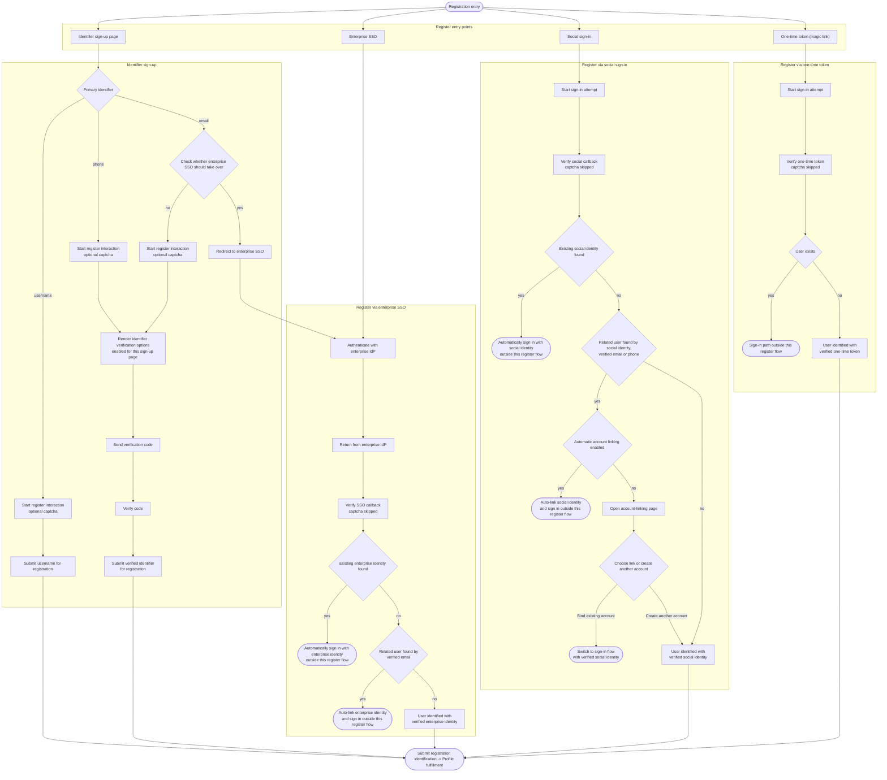
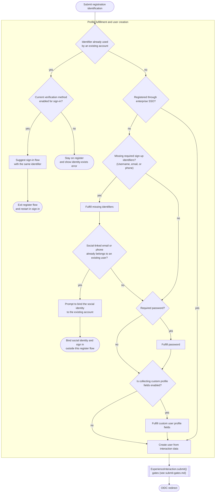

# Register flow

## Registration entries

## Profile fulfillment and user creation

## Post-creation submit & MFA gates

After creating the user, `ExperienceInteraction.submit()` runs the shared gate sequence in [submit-gates.md](./submit-gates.md):

- **Register**: Runs `guardUnreachableRequestedAcr()` instead of `guardFirstFactor()`, skips `guardMfaVerificationStatus()`, and runs mandatory profile, passkey prompt, `assertMfaFulfilled()`, trusted-device opt-in (when an eligible MFA factor was bound), and final ACR assertion.
- **Enterprise SSO / Social registration**: Enterprise SSO skips mandatory profile, passkey prompt, and `assertMfaFulfilled()` (unless requested `mfa` ACR or requested enrollment factors apply); Social skips mandatory profile when `skipRequiredIdentifiers` is enabled.
