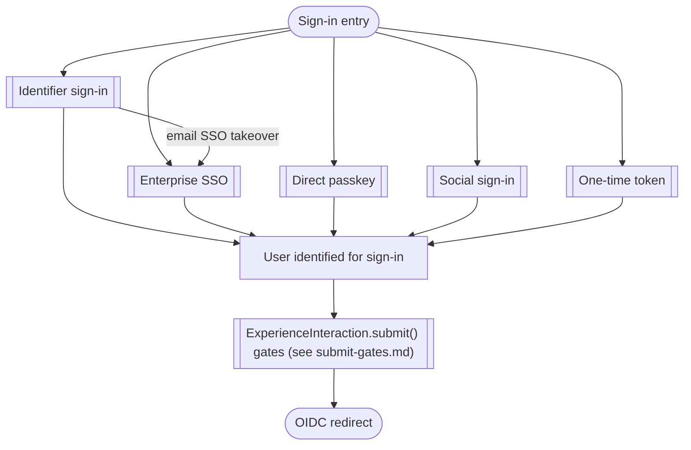
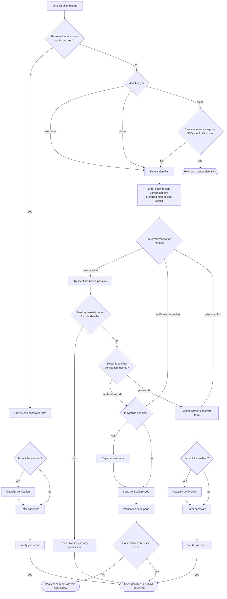
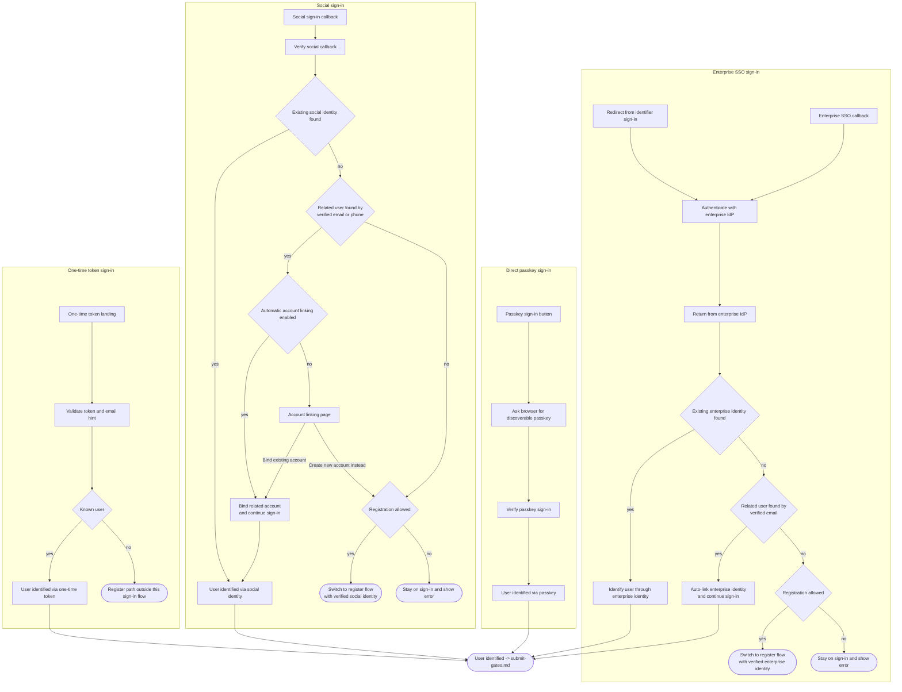

# Sign-in flow

## Overview

## Identifier sign-in

## External, passkey, and one-time token entries

## Post-identification submit & MFA gates

Once identified, `ExperienceInteraction.submit()` runs the shared gate sequence in [submit-gates.md](./submit-gates.md):

- **Sign-in**: Runs all gates (`0` through `7`) in `submit()` order, including `guardFirstFactor()` and `guardMfaVerificationStatus()`.
- **Enterprise SSO**: Skips `guardMfaVerificationStatus()` (unless a requested `mfa` ACR is unmet), skips mandatory profile and passkey prompt, and skips `assertMfaFulfilled()` (unless a requested `mfa` ACR is unmet or requested enrollment factors apply).
- **Passkey sign-in**: Verified sign-in passkey skips `guardMfaVerificationStatus()` unless a requested `mfa` ACR is unmet; subsequent profile, `assertMfaFulfilled()`, trusted-device opt-in, and final ACR gates still apply.
