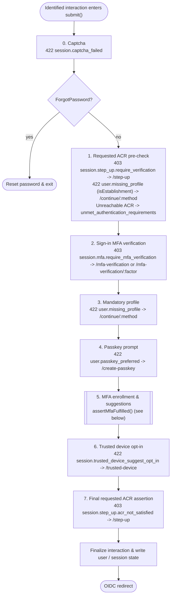
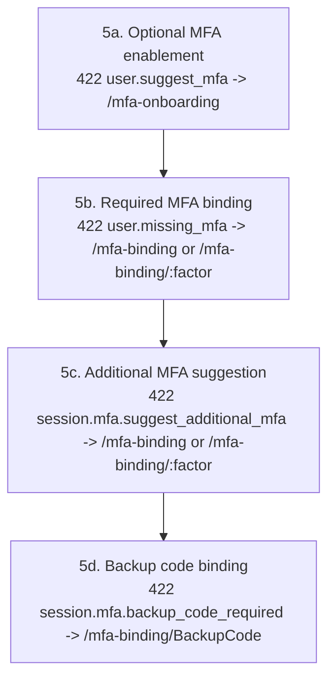

# Submit & MFA gates (`ExperienceInteraction.submit()`)

## Gate order

## Gate 5: MFA enrollment & suggestions

`canBindMfa()` / `getMfaBindingBlock()` gates binding prompts in Gates 4, 5c, and 5d: a password-only sign-in that skipped Gate 2 may not enroll an MFA factor or passkey before proving an existing factor.

## Entry exemptions

| Gate | Sign-in | Register | Enterprise SSO | Passkey sign-in | Forgot password |
| --- | --- | --- | --- | --- | --- |
| 0. Captcha | Runs | Runs | Runs | Runs | Runs, then resets password & exits |
| 1. Requested ACR pre-check | `guardFirstFactor()` | `guardUnreachableRequestedAcr()` | `guardFirstFactor()` / `guardUnreachableRequestedAcr()` | `guardFirstFactor()` | Skipped (exited) |
| 2. Sign-in MFA verification | Runs | Skipped | Skipped unless requested `mfa` ACR unmet | Skipped unless requested `mfa` ACR unmet | Skipped (exited) |
| 3. Mandatory profile | Runs | Runs | Skipped | Runs | Skipped (exited) |
| 4. Passkey prompt | Runs | Runs | Skipped | Runs | Skipped (exited) |
| 5. MFA enrollment (5a–5d) | Runs | Runs | Skipped unless requested `mfa` ACR unmet or requested enrollment applies | Runs | Skipped (exited) |
| 6. Trusted device opt-in | Runs (if eligible MFA proof) | Runs (if eligible MFA proof) | Runs (if eligible MFA proof) | Runs (if eligible MFA proof) | Skipped (exited) |
| 7. Final requested ACR | Runs | Runs | Runs | Runs | Skipped (exited) |

Note: Social sign-in and register also skip Gate 3 (`Mandatory profile`) when `skipRequiredIdentifiers` is enabled in the social sign-in settings. Entry flows: [sign-in-flow.md](./sign-in-flow.md), [register-flow.md](./register-flow.md), [forgot-password-flow.md](./forgot-password-flow.md).

## Implementation & matrix test links

| Gate / Aspect | Implementation | Matrix tests / Experience error handler |
| --- | --- | --- |
| `submit()` orchestration | [ExperienceInteraction.submit()](../packages/core/src/routes/experience/classes/experience-interaction.ts#L1087-L1206) | [use-submit-interaction-error-handler.ts](../packages/experience/src/hooks/use-submit-interaction-error-handler.ts) |
| 0. Captcha | [guardCaptcha()](../packages/core/src/routes/experience/classes/experience-interaction.ts#L1447-L1454) | — |
| 1. Requested ACR pre-check | [guardFirstFactor()](../packages/core/src/routes/experience/classes/experience-interaction.ts#L874-L935), [guardUnreachableRequestedAcr()](../packages/core/src/routes/experience/classes/experience-interaction.ts#L1537-L1547) | [use-step-up-error-handler.ts](../packages/experience/src/hooks/use-step-up-error-handler.ts) |
| 2. Sign-in MFA verification | [guardMfaVerificationStatus()](../packages/core/src/routes/experience/classes/experience-interaction.ts#L692-L754), [resolveMfaVerificationRequirement()](../packages/core/src/routes/experience/classes/libraries/mfa-verification-decision.ts#L184) | [`resolveMfaVerificationRequirement decision matrix`](../packages/core/src/routes/experience/classes/libraries/mfa-verification-decision.test.ts#L314), [`ExperienceInteraction MFA verification audit log and binding agreement`](../packages/core/src/routes/experience/classes/libraries/mfa-verification-decision.integration.test.ts#L121), [use-mfa-error-handler.ts](../packages/experience/src/hooks/use-mfa-error-handler.ts) |
| Binding eligibility (`canBindMfa`) | [canBindMfa()](../packages/core/src/routes/experience/classes/experience-interaction.ts#L763-L765), [getMfaBindingBlock()](../packages/core/src/routes/experience/classes/experience-interaction.ts#L1777-L1819) | Covered by [`ExperienceInteraction MFA verification audit log and binding agreement`](../packages/core/src/routes/experience/classes/libraries/mfa-verification-decision.integration.test.ts#L121) |
| 3. Mandatory profile | [Profile.assertUserMandatoryProfileFulfilled()](../packages/core/src/routes/experience/classes/profile.ts#L220-L270) | [use-submit-interaction-error-handler.ts](../packages/experience/src/hooks/use-submit-interaction-error-handler.ts) |
| 4. Passkey prompt | [Mfa.assertPasskeySignInFulfilled()](../packages/core/src/routes/experience/classes/mfa.ts#L489-L505) | [use-missing-passkey-error-handler.ts](../packages/experience/src/hooks/use-missing-passkey-error-handler.ts) |
| 5. MFA enrollment (5a–5d) | [Mfa.assertMfaFulfilled()](../packages/core/src/routes/experience/classes/mfa.ts#L467-L487), [assertOptionalMfaEnablement()](../packages/core/src/routes/experience/classes/mfa.ts#L532-L545), [assertUserMandatoryMfaFulfilled()](../packages/core/src/routes/experience/classes/mfa.ts#L547-L601), [guardAdditionalBindingSuggestion()](../packages/core/src/routes/experience/classes/mfa.ts#L610-L646), [resolveMfaEnrollmentRequirement()](../packages/core/src/routes/experience/classes/libraries/mfa-enrollment-decision.ts#L213), [mfa-additional-suggestion.ts](../packages/core/src/routes/experience/classes/libraries/mfa-additional-suggestion.ts) | [`resolveMfaEnrollmentRequirement`](../packages/core/src/routes/experience/classes/libraries/mfa-enrollment-decision.test.ts#L391), [use-mfa-error-handler.ts](../packages/experience/src/hooks/use-mfa-error-handler.ts) |
| 6. Trusted device opt-in | [TrustedDevice.assertOptInDecision()](../packages/core/src/routes/experience/classes/trusted-device.ts#L81-L113) | [use-trusted-device-opt-in-error-handler.ts](../packages/experience/src/hooks/use-trusted-device-opt-in-error-handler.ts) |
| 7. Final requested ACR | [experience-interaction.ts](../packages/core/src/routes/experience/classes/experience-interaction.ts#L1199-L1206) | [use-step-up-error-handler.ts](../packages/experience/src/hooks/use-step-up-error-handler.ts) |
